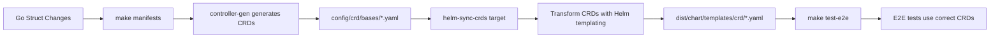

# CRD Synchronization

The chart's CRDs are generated, not hand-written. `make manifests` writes
`config/crd/bases/*.yaml` from the Go types in `api/infra/v2alpha1/`, and `make helm-sync-crds`
renders those into `dist/chart/templates/crd/*.yaml`. One schema, two copies, and a target that keeps
them identical.

## Why The Chart Has Its Own Copy

A chart that carries a hand-maintained copy of a CRD goes stale the first time a field is added: the
deployed schema refuses the object the operator writes, the e2e run fails on a field the chart does
not know, and the release publishes a `groups`/`nodes` pair that cannot serve a scale-up. The sync
target removes the manual step:



Three CRDs, in both directories. A release that installs `groups` and `nodes` without `nodeclaims`
cannot serve a scale-up: the provider creates a `NodeClaim` per machine it is asked for, and the
operator needs `nodeclaims/status` and `nodeclaims/finalizers` to run one to its end.

## Components

### The sync script (`hack/sync-helm-crds.sh`)

Transforms the generated CRDs into Helm-templated versions:

- **input**: `config/crd/bases/*.yaml` (kubebuilder output)
- **output**: `dist/chart/templates/crd/*.yaml` (Helm templates)
- **transformations**: wraps each CRD in `{{- if .Values.crd.enable }}`, adds
  `{{- include "chart.labels" . | nindent 4 }}`, adds the conditional
  `{{- if .Values.crd.keep }}` keep annotation, and preserves the kubebuilder schema exactly

### Makefile integration

- **`helm-sync-crds`** runs the sync script
- **the chain**: `manifests` → `helm-sync-crds` → `build` → `test-e2e`, so the CRDs are synced
  whenever the manifests are generated

### The validation script (`hack/validate-helm-crds.sh`)

Compares the schema sections of the source and the target CRDs, checks that the Helm templating is
applied, and reports a template that was edited by hand.

## Usage

The sync runs on the standard targets, so there is nothing to remember:

```bash
make manifests     # CRDs, RBAC and webhook manifests into config/
make build         # generates, syncs the chart's CRDs, formats, vets, builds
make test-e2e      # the same, then the k3d suite
```

To run the steps directly:

```bash
make helm-sync-crds        # config/crd/bases -> dist/chart/templates/crd
./hack/validate-helm-crds.sh   # are the two copies in sync?
```

`./hack/validate-helm-crds.sh` exits non-zero when a chart CRD's schema section differs from the
generated one.

## Changing A Type

1. Edit the Go types in `api/infra/v2alpha1/`
2. `make manifests` — controller-gen regenerates the CRDs, and the sync renders them into the chart
3. `make test-e2e` — the suite runs against the chart's copy
4. Commit the Go change **and** the regenerated `config/crd/bases/` and `dist/chart/templates/crd/`
   files: a chart CRD is a generated artifact, and a PR that edits one by hand fails validation

## File Structure

```
├── api/infra/v2alpha1/
│   ├── group_types.go              # Go struct definitions
│   ├── node_types.go
│   └── nodeclaim_types.go
├── config/crd/bases/               # Kubebuilder-generated CRDs
│   ├── infra.homecluster.dev_groups.yaml
│   ├── infra.homecluster.dev_nodes.yaml
│   └── infra.homecluster.dev_nodeclaims.yaml
├── dist/chart/templates/crd/       # Helm-templated CRDs
│   ├── infra.homecluster.dev_groups.yaml
│   ├── infra.homecluster.dev_nodes.yaml
│   └── infra.homecluster.dev_nodeclaims.yaml
└── hack/
    ├── sync-helm-crds.sh          # CRD sync script
    └── validate-helm-crds.sh      # CRD validation script
```

## Chart Values That Control The CRDs

```yaml
# values.yaml
crd:
  enable: true   # render the three CRDs into the release
  keep: true     # add helm.sh/resource-policy: keep, so uninstall leaves them
```

`crd.enable: true` puts the CRDs in the release **as templates**, so `helm upgrade` replaces their
schemas. `crd.keep: true` keeps them, and every `Group`, `Node` and `NodeClaim` in them, through
`helm uninstall`. A chart that carries CRDs in a `crds/` directory behaves the other way round: Helm
installs them once and never replaces or drops a served version. The migration from `v1alpha1` states
what that costs an operator: [Upgrade 0.1 to 0.2](../releases/upgrade-0.1-to-0.2.md).

## Troubleshooting

**A schema mismatch, or an e2e failure on a field the chart does not know.**
`./hack/validate-helm-crds.sh`, then `make helm-sync-crds`, then re-check the Go type against the
schema you expected.

**The sync script fails.** `ls config/crd/bases/` (run `make manifests` if it is empty), and check the
script is executable: `chmod +x hack/sync-helm-crds.sh`.

**Validation reports a difference.** A hand edit to `dist/chart/templates/crd/` is the usual cause:
re-run `make helm-sync-crds` and commit the regenerated file.

## What The Tests Keep Honest

A generated file is only as good as the check that regenerates it. These are the checks the
documentation quotes, so an operator-facing string cannot rot silently:

- `internal/controller/infra/crd_columns_test.go` asserts the printer columns of the generated CRD
  **and** of the chart's copy, so a schema that synced without its columns fails a test. A printer
  column is a string nothing compiles, and the failure mode of a typo is a silent column in front of
  an operator
- `internal/controller/infra/group_columns_envtest_test.go` asserts the pool's column values against a
  live API server
- `test/integration/duration_snippet_test.go` extracts the duration command and its sample output from
  [the runbook](../troubleshooting/common-issues.md#how-long-has-this-machine-been-up), runs the
  `jq` program over `test/integration/testdata/pool-shape/nodes.json`, and asserts the doc's own
  sample comes out — the doc is the tested artifact
- `internal/phase/hygiene_test.go` asserts on the source that no code outside the writer of
  `Node.status.phase` and its history reads those fields, so the observability stays a report
- `TestReportPhaseCompareAndSetsOnTheObservation` and `TestReportPhaseRefusesAStaleMachine`, in
  `internal/fsm`, pin the compare-and-set on the observation that
  [the state doc](state.md#the-report-has-two-writers-and-the-write-is-a-compare-and-set-on-the-observation)
  states
- `./hack/validate-helm-crds.sh` compares the schema sections of source and target
- `make pre-commit` runs `pre-commit-generate` (manifests, generate, helm-sync), the validation and
  the unit tests, and stages the generated files. `make install-pre-commit` installs the
  [pre-commit](https://pre-commit.com) hooks that run it on every commit
  (`.pre-commit-config.yaml`)

## Related Documentation

- [Development Setup](setup.md) — the targets, and the k3d environment
- [E2E Test Flow](e2e-test-flow.md) — what the suite runs, spec by spec
- [Upgrade 0.1 to 0.2](../releases/upgrade-0.1-to-0.2.md) — what a CRD change costs a running pool
- [Group CRD](../api-reference/crds/group.md), [Node CRD](../api-reference/crds/node.md),
  [NodeClaim CRD](../api-reference/crds/nodeclaim.md) — the schemas these files render
